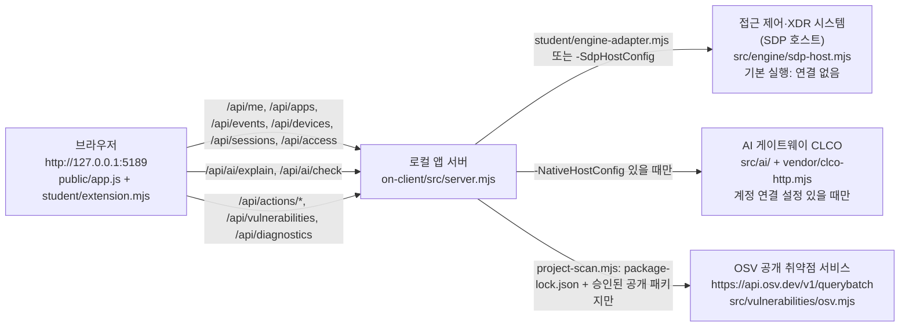

# 학생 실행 설명서 (STUDENT_RUNBOOK)

이 문서는 학생이 새로 작성한 문서이며 제공 문서(`README.md`, `docs/GETTING_STARTED_STUDENT.md` 등)는 고치지 않았습니다. 작성일은 2026-10-27이고 대상 프로젝트는 보안 Agent **Endministrator**(시작 틀 이름: 케셰브, 시작 틀 버전 0.2.11)입니다.

표기 규칙: **실행 확인**은 2026-10-27에 이 PC의 PowerShell과 curl로 직접 실행해 본 것, **코드 확인**은 파일을 읽어서만 확인한 것, **미확인**은 확인하지 못한 것입니다. 미확인 항목을 확인했다고 쓰지 않았습니다.

## 1. 목적과 기능

- 목적: 회사 직원이 자기 로그인 상태, 업무 앱 접근 판정, 최근 접속 기록과 보안 경보, AI 설명과 조치 결과, 설치 패키지의 알려진 취약점 조회 결과를 한 화면에서 보는 보안 앱입니다.
- 기능은 화면 8개입니다. 학생 구현 함수와 1:1로 대응하며 6절에 정리했습니다.
- 기본 실행은 실제 회사 시스템(기존 접속·XDR 시스템)에 연결되지 않은 상태입니다. 이때 "연결 없음"이 보이는 것이 정상 동작입니다.

## 2. 지원 환경과 확인한 버전

| 항목 | 요구 | 이 PC에서 확인한 값 | 구분 |
|---|---|---|---|
| OS | Windows (PowerShell 스크립트 사용) | Windows 11 Pro 10.0.26200 | 실행 확인 |
| Node.js | `package.json`의 engines는 24.19.0, 시작 스크립트는 22~24 허용 | v24.21.0 (수업 기준과 다름. 스크립트가 "참고" 문구만 출력하고 실행됨) | 실행 확인 |
| npm | 외부 의존성 없음, 스크립트 실행용 | 11.19.0 | 실행 확인 |
| PowerShell | `tools\start-alekov.ps1` 실행용 | Windows PowerShell 5.1.26100.9711 | 실행 확인 |
| 브라우저 | PC 브라우저 | 사용자가 `npm run demo` 화면에서 탭 「보안 기록」, 「다시 불러오기」 버튼, `event-01 상세` 형식 버튼, 예제 자료 안내를 확인함. 브라우저 종류·버전은 기록하지 않음 | 사용자 화면 확인 |

지원하지 않는 환경: Node.js 22 미만 또는 25 이상(시작 스크립트가 거절, 코드 확인), Windows 외 OS(스크립트가 PowerShell 기반이며 실행해 보지 않음, 미확인).

## 3. 폴더 구조

Git 최상위 폴더는 `on-client`가 아니라 그 위의 프로젝트 폴더입니다.

```
choi-bujang-secret-vault\          <- Git 최상위 (커밋·제출 기준)
  on-client\                       <- 앱 폴더 (PowerShell을 여는 위치)
    package.json                   <- npm 스크립트: start, demo, check
    .env.example                   <- 비밀 없는 설정 견본
    .on-starter-manifest.json      <- 제공 파일 해시 목록 (제공/학생 경계 기준)
    src\server.mjs                 <- 앱 서버 (제공)
    src\engine.mjs, src\engine\    <- 기존 시스템(SDP) 연결부 (제공)
    src\ai\, vendor\clco-http.mjs  <- AI 게이트(CLCO) 연결부 (제공)
    src\actions\, src\vulnerabilities\  <- 조치·취약점 조회 (제공)
    public\                        <- 화면 틀 (제공): index.html, app.js, style.css
    tools\start-alekov.ps1         <- 시작 스크립트 (제공)
    student\extension.mjs          <- 학생 구현 (화면 8개). manifest의 제공 원본 해시와 다름
    student\engine-adapter.mjs     <- 제공 파일 (기본: disconnected). manifest의 제공 원본 해시와 같음
    docs\STUDENT_RUNBOOK.md        <- 이 문서 (학생 작성)
```

## 4. 실행 절차

작업 위치는 항상 앱 폴더 `...\choi-bujang-secret-vault\on-client`입니다.

1. 파일 탐색기에서 앱 폴더를 열고 주소 표시줄에 `powershell`을 입력해 Enter를 누릅니다. 새 PowerShell 창이 그 폴더에서 열립니다.
2. 아래 명령을 실행합니다. 설치 단계는 없습니다. 외부 npm 의존성이 없고 `on-client`에는 `package-lock.json`도 없습니다(코드 확인).

```powershell
powershell -NoProfile -ExecutionPolicy Bypass -File .\tools\start-alekov.ps1
```

3. **정상 시작 신호**(실행 확인). 아래 문장이 이 순서로 나옵니다. 첫 줄은 Node.js 버전이 24.19.0이 아닐 때만 나옵니다.

```
참고: 지금 Node.js 는 v24.21.0 입니다. 수업 기준은 v24.19.0 입니다.
케셰브가 켜졌습니다. 브라우저에서 http://127.0.0.1:5189/ 을 여세요.
서버가 응답한 것만 확인했습니다. AI 연결 상태는 화면에서 따로 확인해 주세요.
끄려면 이 창에서 Ctrl+C 를 누르세요.
```

4. 브라우저에서 http://127.0.0.1:5189 를 엽니다. 이 주소의 HTTP 응답 코드 200은 확인했습니다(실행 확인). 화면 모양은 미확인입니다.
5. 종료: 실행한 PowerShell 창에서 Ctrl+C를 누릅니다. `-Background`로 실행했다면 안내된 프로세스 번호의 node를 작업 관리자에서 종료합니다. 종료 뒤 5189 포트가 비는 것을 확인했습니다(실행 확인).
6. 재실행: 3번 명령을 다시 실행합니다. 포트가 이미 사용 중이면 `포트 5189 를 다른 프로그램이 쓰고 있습니다...` 문구와 함께 종료 코드 1로 멈춥니다(실행 확인). 이때는 `-Port 5190`처럼 다른 번호를 씁니다.

| 목적 | 명령 (앱 폴더에서) | 확인 결과 |
|---|---|---|
| 기본 실행(연결 없음) | `npm start` | 서버 로그 `케셰브 연결 확인: http://127.0.0.1:5189` (실행 확인. `node src/server.mjs` 직접 실행으로 확인) |
| 예제 자료 실행 | `npm run demo` | 서버 로그 `케셰브 예제: http://127.0.0.1:5189` (실행 확인. 같은 방식) |
| 학생 파일 문법 검사 | `npm run check` | 오류 없이 종료, 종료 코드 0 (실행 확인) |
| 다른 포트 | `powershell -NoProfile -ExecutionPolicy Bypass -File .\tools\start-alekov.ps1 -Port 5190` | 포트 사용 중 거절 문구는 확인, 5190 실행은 미확인 |

`npm run demo`의 예제 자료는 화면 모양 확인용이며 실제 연결이나 성취가 아닙니다. 예제 모드에서 `/api/me`는 `practice-user`, `practice-pc`를 돌려줍니다(실행 확인).

## 5. 구성도

### 5.1 글로 쓴 관계

1. **브라우저**: 사용자가 `http://127.0.0.1:5189`를 엽니다. 화면 틀은 `public/index.html`, `public/app.js`이고, 화면 내용은 `student/extension.mjs`가 만듭니다.
2. **로컬 앱 서버**: `src/server.mjs`가 `127.0.0.1:5189`에서 `/api/...` 요청을 받습니다. 학생 요청 본문으로 DB·정책·엔진을 고를 수 없습니다(코드 확인).
3. **접근 제어·XDR 시스템**: 앱 서버는 제공 파일 `student/engine-adapter.mjs`의 어댑터(기본 `evidenceMode: 'disconnected'`) 또는 SDP 호스트 설정(`-SdpHostConfig`, `src/engine/sdp-host.mjs`)을 통해서만 접근합니다. 기본 실행에서는 연결이 없어 `/api/me`, `/api/apps`, `/api/events`, `/api/devices`, `/api/sessions`가 HTTP 503 `ENGINE_NOT_CONNECTED`를 돌려줍니다(실행 확인).
4. **AI 게이트웨이(CLCO)**: 설명 AI 요청(`/api/ai/explain`, `/api/ai/check`)은 계정 연결 설정(`-NativeHostConfig`)이 있을 때만 `src/ai/`와 `vendor/clco-http.mjs`를 거쳐 나갑니다. 이 설정은 담당자가 발급하며 이 PC에는 없습니다. 따라서 AI 연결은 **미확인**입니다.

5. **OSV 공개 취약점 서비스**: `/api/vulnerabilities` 요청을 받으면 `src/server.mjs`가 만든 `createProjectScanner`(`src/vulnerabilities/project-scan.mjs`)가 `ON_PROJECT_DIRECTORY` 아래의 `package-lock.json`을 읽고, `ON_APPROVED_PUBLIC_PACKAGES`에 승인된 공개 패키지만 `src/vulnerabilities/osv.mjs`를 통해 `https://api.osv.dev/v1/querybatch`로 조회합니다(코드 확인). 이 PC는 두 설정이 비어 있어 외부 조회가 일어나지 않았고(`not_configured`), 실제 OSV 조회는 **미확인**입니다.

### 5.2 Mermaid



### 5.3 표

| 상자 | 실제 파일·주소 | 이 PC에서 확인한 상태 |
|---|---|---|
| 브라우저 | `http://127.0.0.1:5189/` | 응답 코드 200 확인. 예제 모드 화면 일부는 사용자가 확인(8절 참고) |
| 로컬 앱 서버 | `on-client/src/server.mjs` | 시작·응답·종료 확인 |
| 접근 제어·XDR 시스템 | `on-client/src/engine/sdp-host.mjs` (설정 `-SdpHostConfig`) | 연결 없음(503 `ENGINE_NOT_CONNECTED`). 실제 연결은 미확인 |
| AI 게이트웨이(CLCO) | `on-client/src/ai/service.mjs`, `on-client/vendor/clco-http.mjs` (설정 `-NativeHostConfig`) | 설정 없음. `/api/diagnostics`의 `ai.configured`가 `false`(실행 확인). 연결 성공은 미확인 |
| OSV 공개 취약점 서비스 | `https://api.osv.dev/v1/querybatch` (`on-client/src/vulnerabilities/osv.mjs`, 호출 조립 `project-scan.mjs`, 설정 `ON_PROJECT_DIRECTORY`·`ON_APPROVED_PUBLIC_PACKAGES`) | 이 PC는 설정이 비어 있어 `/api/vulnerabilities`가 `not_configured`(실행 확인). 실제 OSV 조회는 미확인 |

## 6. 구현 함수, 제공 코드 경계, 확인한 기능

### 6.1 제공 코드와 학생 코드의 경계

- 기준: `on-client/.on-starter-manifest.json`의 `sourceHashes`가 제공 파일의 해시 목록입니다.
- 제공: `src/` 아래 전부, `public/` 아래 전부, `vendor/`, `tools/`, `package.json`, `.env.example`, 기존 `docs/` 문서와 `README.md`. 학생 코드 작업에서는 이 파일들을 고치지 않았습니다. 예외는 `public/index.html` 하나입니다. 13단계에서 학생 지시로 제목과 앱 이름만 Endministrator로 바꿨고(커밋 `f14fe98`), 그 밖의 `public/` 파일은 그대로입니다. manifest 해시 대조(2026-10-27)에서 제공 원본과 내용이 다른 파일은 `public/index.html`과 `student/extension.mjs` 두 개뿐입니다.
- 해시 대조 주의: 제공 원본 중 일부는 줄바꿈이 CRLF입니다. Git 설정 `core.autocrlf=true`인 Windows PC에서는 새로 내려받은 폴더의 파일 줄바꿈이 바뀌어 원문 그대로 계산하면 제공 파일 대부분의 해시가 manifest와 다르게 나옵니다. Git에 저장된 원본의 줄바꿈을 CRLF로 되돌려 계산하면 `docs/AI_SETUP_GUIDE.md`와 `tools/start-alekov.ps1`은 제공 원본과 일치합니다(2026-10-27 새 폴더에서 확인).
- 제공(수정하지 않음) 중 `student/` 폴더에 있는 `student/engine-adapter.mjs`: manifest에 제공 파일로 기록되어 있고, 현재 파일의 SHA-256이 manifest 값과 같습니다(2026-10-27 대조). 기본값 `{ evidenceMode: 'disconnected' }` 그대로이며 임의 로그인값이나 전체 사건 조회를 만들어 넣지 않았습니다.
- 학생 영역: `student/extension.mjs`와 이 문서(`docs/STUDENT_RUNBOOK.md`)뿐입니다. `extension.mjs`는 manifest에 시작 틀로 기록되어 있지만 현재 SHA-256이 제공 원본과 달라 학생이 구현한 파일로 분류합니다. 이 문서는 manifest에 없는 새 파일입니다.

### 6.2 `student/extension.mjs`의 구현 함수

`createStudentView()`가 아래 8개 메서드를 돌려줍니다. 내부 함수는 `render...View`입니다. 모든 DOM은 `createElement`와 `textContent`로 만들고, 상태는 색상과 함께 글자로도 구분합니다.

| 단계 | 메서드 | 보여 주는 것 |
|---|---|---|
| 13 | `renderIdentity` | 로그인 사용자, PC, 세션을 보여 줍니다. PC는 보안 기준 충족·미충족·확인 불가, 세션은 활성·만료·철회됨·확인 불가로 글자와 `data-level`로 구분합니다. 연결 모드(demo·disconnected·unknown) 안내를 붙입니다. |
| 14 | `renderDecision` | 업무 앱 접근 판정을 접근 허용(allow)·접근 거부(deny)·추가 인증 또는 확인 필요(challenge)·판정 확인 불가(unknown)로 구분하고 `data-decision`에 값을 둡니다. 목록에 없는 값은 unknown으로 처리하고 받은 값을 따로 적습니다. 허용을 앱 접속 성공으로 표시하지 않습니다. |
| 15 | `renderEvents` | 최근 보안 기록 목록을 종류·앱·접근 결과 필터로 걸러 보여 주고, 기록마다 있는 `<사건 ID> 상세` 버튼(예: `event-01 상세`)으로 근거·규칙·상태를 봅니다. 한 줄에 `data-student-event-id`, 상세에 `data-student-event-detail`을 둡니다. 필터 선택은 같은 화면 안에서만 유지합니다. |
| 16 | `renderStatus` | PC·세션·알림 상태와 도움정보(diagnostics)를 보여 줍니다. 연결 없음·기록 없음·미지원 조치 안내를 구분하고, 다시 시도는 사용자가 「다시 불러오기」를 직접 누릅니다. |
| 17 | `renderAiConnection` | 앱 안 AI 연결 상태를 보여 줍니다. 오류 코드는 8개 묶음(권한 준비 중·확인 불가, 인증 실패, 접근 제한, 반 사용량·이용 한도, 이용 시간 아님, 요청 제한·시간 초과·네트워크, 취소됨, 쓸 수 있는 모델 없음)으로 안내하고 열쇠·URL이 든 메시지는 가립니다. |
| 18 | `renderExplanation` | 사건에 대한 AI 설명을 근거 ID와 대조해 보여 줍니다. 근거가 맞지 않으면 설명을 사실처럼 보이지 않습니다. 사건에 `data-student-explanation-event`를 둡니다. |
| 19 | `renderAction` | 조치 요청 상태 11가지(idle·loading·prepared·executing·pending·succeeded·denied·failed·unknown·expired·error)를 구분합니다. 접수 응답(ACK)은 효과가 아니며, 효과 확인은 `succeeded`일 때만 보입니다. `data-student-action-event`, `data-student-action-request`를 둡니다. |
| 20 | `renderVulnerabilities` | 설치 패키지 버전과 알려진 취약점 조회 결과를 보여 줍니다. 조회 상태 5가지(complete·partial·not_checked·not_configured·unverifiable)를 원래 값과 함께 적고, 미조회·실패를 취약점 없음으로 보이지 않습니다. `data-student-package-name`, `data-student-package-version`을 둡니다. |

### 6.3 확인한 기능과 확인 방법

| 기능 | 확인 방법 | 결과 |
|---|---|---|
| 학생 파일 문법 | `npm run check` 실행 | 통과 (실행 확인) |
| 서버 기동·응답·종료 | `start-alekov.ps1 -Background`, HTTP 요청, 프로세스 종료 | 응답 200, 종료 뒤 포트 비워짐 (실행 확인) |
| 포트 중복 거절 | 같은 포트로 두 번째 실행 | 거절 문구와 종료 코드 1 (실행 확인) |
| 연결 없음 응답 | `/api/me` 등 5개 | 503 `ENGINE_NOT_CONNECTED`, `meta.mode`가 `disconnected` (실행 확인) |
| 취약점 조회 기본 상태 | `/api/vulnerabilities` | 200, `status: not_configured`, `code: PROJECT_NOT_CONFIGURED`, 패키지 0개 (실행 확인) |
| 도움정보 | `/api/diagnostics` | 200, `ai.configured: false` (실행 확인) |
| 예제 모드 | `npm run demo`의 `/api/me`, `/api/events` | `practice-user`와 예제 기록 응답 (실행 확인) |
| 화면 8개의 분기 동작 | 앞 단계에서 모의 DOM으로 점검 | 모의 데이터 점검만 함. 이 문서 작성 중 재실행하지 않음 (코드 확인) |

## 7. 오류별 확인 순서

화면과 서버에 실제로 나오는 문구 기준입니다. 순서대로 위에서 아래로 확인합니다.

| 증상(실제 문구) | 원인 | 확인 순서 | 복구 |
|---|---|---|---|
| `앱 폴더가 아닙니다. 받은 시작 틀의 on-client 폴더 안에서 ...` | 다른 폴더에서 스크립트를 실행함 | 1) PowerShell의 현재 위치가 `on-client`인지 확인 2) `src\server.mjs` 존재 확인 | `on-client`에서 PowerShell을 다시 엽니다. |
| `Node.js 가 없습니다` / `앱은 Node.js 22~24 에서 실행합니다` | Node.js 미설치 또는 버전 범위 밖 | `node --version` 실행 | Node.js 24.19.0을 설치한 뒤 PowerShell을 새로 엽니다. |
| `포트 5189 를 다른 프로그램이 쓰고 있습니다` | 이미 서버가 켜져 있거나 다른 프로그램이 사용 중 | 1) 이전 창이 열려 있는지 확인 2) 다른 프로그램은 종료하지 않고 둠 | `-Port 5190`처럼 다른 번호로 실행합니다. |
| `앱 서버가 N 초 안에 뜨지 않았습니다` | 서버가 제때 시작하지 못함 | 창의 메시지를 그대로 확인 | 메시지를 담당 강사에게 보여 줍니다. (이 오류는 재현해 보지 않음, 미확인) |
| `연결 없음: 실제 회사 시스템에 연결되지 않았습니다 (disconnected)` / `ENGINE_NOT_CONNECTED` | 기본 실행에서 기존 시스템 연결 설정이 없음 | `-SdpHostConfig`로 켰는지 확인 | 정상 동작입니다. 실제 연결은 담당자가 설정을 발급한 뒤 `-SdpHostConfig`로 켭니다. |
| `확인 불가: 자료의 연결 상태를 확인할 수 없습니다 (unknown)` | 응답 형식 불일치(`CONTRACT_MISMATCH`, `ENGINE_RESULT_UNVERIFIED`) | 응답의 `meta.mode`와 코드 확인 | 정상으로 보지 않습니다. 담당자에게 코드를 전달합니다. |
| `NATIVE_HOST_DISABLED` / `호스트 로그인 연결을 먼저 준비하세요.` | 계정 연결 설정(`-NativeHostConfig`) 없이 켬 | 서버를 어떤 옵션으로 켰는지 확인 | 담당자에게 설정 파일 경로를 받아 `-NativeHostConfig`로 켭니다. 설정 파일은 직접 만들거나 복사하지 않고 내용을 열지도 않습니다. |
| `권한 준비 중·확인 불가` (`ON_AI_PROVISIONING_PENDING` 등) | AI 계정 연결·앱 권한 미준비 | 화면의 오류 코드 확인 | 학생 잘못이 아닐 수 있습니다. 담당자에게 계정 연결과 앱 권한 확인을 요청합니다. |
| `인증 실패`(`WB_CLCO_AUTH_REQUIRED`), `접근 제한`(`WB_CLCO_ACCESS_BLOCKED`) | AI 인증·이용 권한 문제 | 계정 연결 상태 확인 | 열쇠를 복사해 붙이지 않고 담당자에게 확인합니다. |
| `요청 제한·시간 초과·네트워크` / `시간 초과: ... 요청이 제한 시간 안에 끝나지 않았습니다` | 요청 제한 또는 지연 | 잠시 기다린 뒤 상태 확인 | 「다시 불러오기」를 직접 누릅니다. 자동 재요청은 하지 않습니다. |
| `조회 준비 미완료(not_configured)` | 취약점 조회 대상 프로젝트 설정 없음 | `.env.example`의 `ON_PROJECT_DIRECTORY`, `ON_APPROVED_PUBLIC_PACKAGES` 확인 | 설정은 운영자 몫입니다. 취약점이 없다는 뜻이 아닙니다. |
| `lock 파일 확인 불가(unverifiable)` | `package-lock.json`을 확인할 수 없음 | 대상 프로젝트의 lock 파일 존재 확인 | 취약점이 없다는 뜻이 아닙니다. 대상 프로젝트 설정을 확인합니다. |
| `아직 조회 안 함(not_checked)` / `일부 조회 실패(partial)` | 승인된 공개 패키지가 없음 / 일부 조회 실패 | `ON_APPROVED_PUBLIC_PACKAGES` 확인 | 실패한 패키지는 취약점이 없는 것이 아닙니다. |
| 조치 `pending`, `unknown`, `expired` | 접수만 됨 / 결과 불명 / 확인 기한 지남 | 제공 화면의 「원천 결과만 재조회」로 결과만 다시 조회 | 같은 조치를 다시 집행하지 않습니다. `expired`는 조치를 다시 준비합니다. |

## 8. 미확인 기능과 지원하지 않는 범위

| 항목 | 상태 | 이유 |
|---|---|---|
| 실제 기존 접속·XDR 시스템(SDP) 연결 | 미확인 | `-SdpHostConfig` 설정이 없음 |
| 앱 안 AI 계정 연결과 실제 AI 설명 성공 | 미확인 | `-NativeHostConfig`가 없고 서버가 `NATIVE_HOST_DISABLED` 상태. 이 PC의 `ai.configured`는 `false` |
| 실제 조치 집행기 연결과 조치 효과 확인 | 미확인 | 집행기 연결 설정 없음. 화면 코드는 `succeeded`일 때만 효과를 표시하도록 작성됨(코드 확인) |
| 실제 OSV 조회와 `package-lock.json` 대조 | 미확인 | `ON_PROJECT_DIRECTORY`, `ON_APPROVED_PUBLIC_PACKAGES`가 비어 있고 `on-client`에는 lock 파일이 없음 |
| 브라우저 화면 렌더링 중 위 항목 외의 화면, 키보드 조작 | 미확인 | 사용자가 확인한 것은 「보안 기록」 탭, 「다시 불러오기」 버튼, `event-01 상세` 형식 버튼, 예제 자료 안내(demo)뿐임 |
| `-Background`/`-Port 5190` 실행 중 5190 포트 | 미확인 | 5189만 실행함 |
| 서버 기동 지연 오류(`N 초 안에 뜨지 않았습니다`) | 미확인 | 재현하지 않음 |
| macOS·Linux 실행 | 지원하지 않음 | 시작 스크립트가 Windows PowerShell 기반 |
| 새 폴더에서의 재설치 재현 | 연결 없음·예제 자료 범위만 확인 | 22단계에서 `git clone -b on-21`로 받은 새 폴더에서 실행함. 결과와 미확인 항목은 `STUDENT_RELEASE_CHECK.md`, 보존 계획은 `STUDENT_DATA_PLAN.md` 참고 |

## 9. 지킬 것

- 키·토큰·비밀번호·API 키는 코드, 커밋, 이 문서, 캡처에 넣지 않습니다. 설정이 필요하면 커밋에서 빠지는 `.env` 같은 파일에만 둡니다.
- 제공 파일(`src/`, `public/`, `tools/` 등)은 고치지 않습니다.
- 확인하지 못한 연결이나 실행을 성공으로 쓰지 않습니다.
